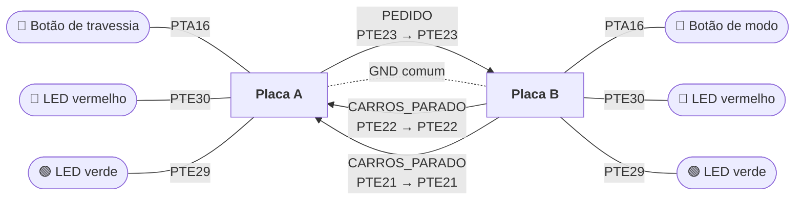

### Arquitetura

- 

---

### Fiação

#### Placa A 

| Função | GPIO | Observação |
|---|---|---|
| Botão de travessia | A16 | ... |
| LED vermelho externo | PTE30 | ... |
| LED verde externo | PTE29 | ... |
| Output PEDIDO | PTE23 | ... |
| Input CARROS_PARADO | PTE22 | ... |
| Input CARROS_PARADO | PTE21 | ... |

#### Placa B 

| Função | GPIO | Observação |
|---|---|---|
| Botão de modo | A16 | ... |
| LED vermelho externo| PTE30 | ... |
| LED verde externo | PTE29 | ... |
| Input PEDIDO | PTE23 | ... |
| Output CARROS_PARADO | PTE22 | ... |
| Output CARROS_PARADO | PTE21 | ... |

